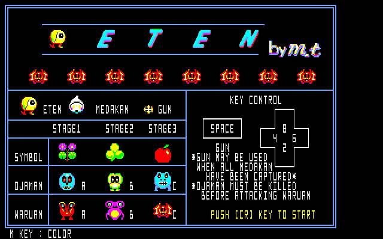
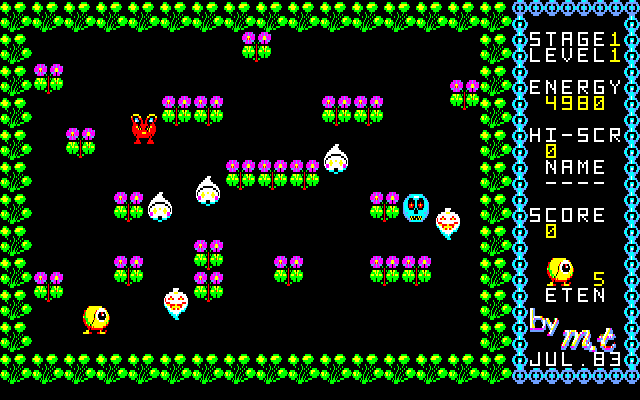
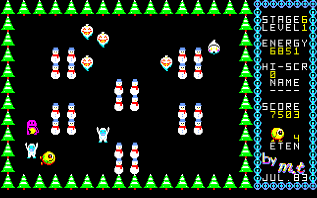
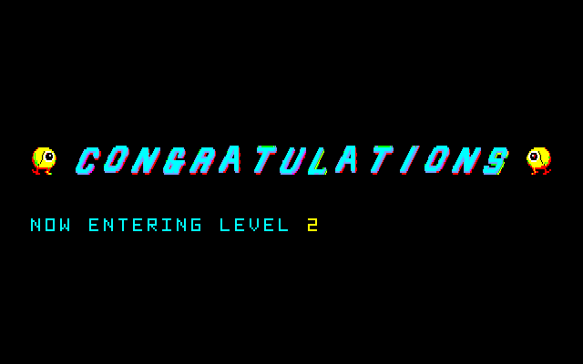

# ETEN（イーテン）

シャープ MZ-2000 / MZ-2200 用のアクションゲームです。
原作は m.t による BASIC とマシン語のゲームで、工学社「I/O」1983年11月号に掲載されました。
このリポジトリは、原作者の許諾を得て nezipop が 2026年にカラー化し、全部をマシン語に書き直したリメイク版です。IPL から起動します。

[English summary below](#english)

| ステージ1（草原） | ステージ6（雪） | 全面クリア |
|---|---|---|
|  |  |  |

## ファイル

`ETEN_REMASTER.zip` をダウンロードして展開してください。中に次の2つが入っています。

| ファイル | 内容 |
|---|---|
| `ETEN.mzt` | テープイメージ（MZT 形式） |
| `ETEN.d88` | フロッピーディスクイメージ（D88 形式、IPL 起動） |

どちらも中身は同じです（バージョン 1.7）。

## 動く環境

- MZ-2000 / MZ-2200 の実機と、エミュレータ EmuZ-2200 で動作を確認しています。
- 画面はグラフィック RAM に描きます。カラーモニタではカラーで遊べます。
- モノクロ（グリーン）モニタの場合は、タイトル画面で M キーを押すと単色表示になります。

## 起動のしかた

- **ETEN.d88**：ディスクを入れて電源を入れる（またはリセット）と、IPL から起動します。
- **ETEN.mzt**：IPL のテープ読み込みで起動します。

タイトル画面で CR キーを押すとゲームが始まります。

## 操作

| キー | 動作 |
|---|---|
| テンキー 8 / 4 / 6 / 2 | 上 / 左 / 右 / 下に移動 |
| SPACE | GUN を撃つ（押し続けると連射。4 か 6 を一緒に押すとその向きに撃つ） |
| M | カラー / 単色の切り替え（タイトル画面） |
| CR | ゲーム開始 |
| Y / N | ゲームオーバー後、Y で同じステージから続ける、N でタイトルへ |

## 遊び方

- イーテンを動かして、画面にいるメダカンを全部つかまえます。
- メダカンを全部つかまえると GUN が使えるようになります。
- オジャマンを先に倒してから、ワルアンを倒します。全部倒すとステージクリアです。
- オジャマンにぶつかるとエネルギーが減ります。ワルアンに捕まるとイーテンが1人減ります。
- エネルギーは時間とともに減り、0 になると TIME OVER です。
- ステージは6面あり、全部クリアするとレベルが上がって、また1面から始まります。イーテンも1人増えます。
- イーテンは5人から始まります。

### ステージ

| ステージ | 場所 | オジャマン | ワルアン |
|---|---|---|---|
| 1 | 草原 | ドクロ | 赤い怪物 |
| 2 | 草花 | フクロウ（強） | ピンクの宇宙人 |
| 3 | 森 | 青い怪物 | 赤い太陽 |
| 4 | 池 | カエル | 紫のキバ怪獣 |
| 5 | 砂漠 | 緑のクマ（強） | 赤いオニ |
| 6 | 雪 | ピンクのおばけ | 雪男 |

「強」のオジャマンは、ぶつかったときにエネルギーが多く減ります。

## 元の版からの主な変更

- BASIC（MZ-1Z001）とマシン語の2本立てだったものを、全部マシン語にして IPL から起動するようにした。
- 画面をカラーにした（タイトルでカラー / 単色を選べる）。文字もすべてグラフィックで描く。
- 元の BASIC 版と同じ速さで動くように合わせた。
- ステージを3面から6面に増やした（4〜6面は新しい壁・障害物・敵）。
- 撃つキーを SPACE にし、連射と撃つ向きの指定をできるようにした。
- イーテンの初期人数を3人から5人に、ゲームオーバー後のコンティニューを追加。
- 英語の表示を見直した（CONGRATULATIONS など）。

## クレジット

- 原作：m.t（工学社「I/O」1983年11月号 掲載、画面の「by m.t JUL.83」）
- リメイク（2026年、カラー化・全マシン語化・ステージ追加）：nezipop と Claude（Anthropic）
  - nezipop：原作者からの許諾の取得、方針、デザイン（配色・キャラクター）、実機・エミュレータでの試験
  - Claude：原作の解析、プログラム

## ライセンス

原作 © 1983 m.t. All rights reserved.
このリメイク版は、原作者 m.t の許諾を得て nezipop が公開しています。

遊ぶこと、プレイ動画や画面を紹介することは自由です。
改変・再配布をしたい場合は、先に nezipop に相談してください（GitHub の Issue でご連絡ください）。

---

## English

**ETEN** is an action game for the Sharp MZ-2000 / MZ-2200.
The original game by m.t, written in BASIC and machine language, was published in the November 1983 issue of Kohgakusha's "I/O" magazine.
This repository is a 2026 remake by nezipop, made with the original author's permission: colorized, rewritten entirely in machine language, and bootable from IPL.

### Files

Download and unzip `ETEN_REMASTER.zip`. It contains:

- `ETEN.mzt` – tape image (MZT)
- `ETEN.d88` – floppy disk image (D88, boots from IPL)

Both contain the same game (version 1.7). Tested on real MZ-2000 / MZ-2200 machines and on the EmuZ-2200 emulator.

### Controls

| Key | Action |
|---|---|
| Numeric keypad 8 / 4 / 6 / 2 | Move up / left / right / down |
| SPACE | Fire the GUN (hold for rapid fire; hold 4 or 6 to choose the direction) |
| M | Color / monochrome display (title screen) |
| CR | Start |
| Y / N | After game over: Y continues from the same stage, N returns to the title |

### How to play

- Catch every MEDAKAN on the screen. Once all are caught, the GUN can be used.
- Shoot the OJAMAN first, then the WARUAN. Defeat them all to clear the stage.
- Touching an OJAMAN costs energy; being caught by a WARUAN costs a life.
- Energy runs down over time; at zero it is TIME OVER.
- There are 6 stages. After the sixth, the level goes up and you start again from stage 1 with one extra life. You start with 5 lives.

### Credits

- Original game: m.t (published in "I/O", November 1983)
- Remake (2026: colorization, machine-language rewrite, new stages): nezipop and Claude (Anthropic)
  - nezipop: permission from the original author, direction, design (colors and characters), testing on real hardware and the emulator
  - Claude: analysis of the original, programming

### License

Original game © 1983 m.t. All rights reserved.
This remake is published by nezipop with the permission of the original author, m.t.
You are free to play the game and to show it (videos, screenshots). Please contact nezipop (via a GitHub issue) before modifying or redistributing it.
